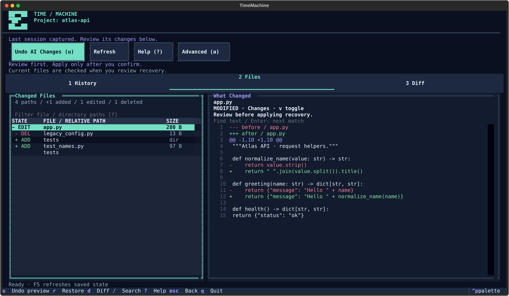
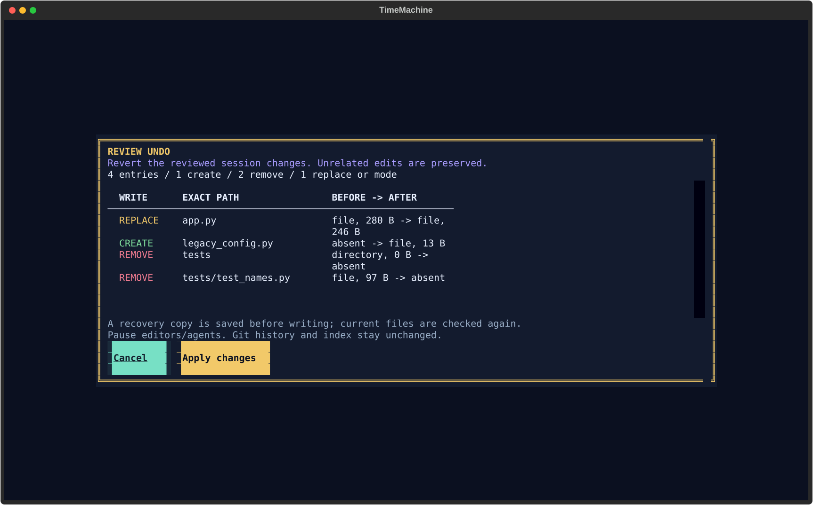

**Safely undo AI coding agent changes while preserving unrelated work.**

TimeMachine saves selected local files before and after a coding-agent session.
Review the diff and undo that session while preserving unrelated work. It captures
selected untracked and ignored files, and keeps your Git index and history intact.
No account, daemon or API key is required by TimeMachine.

## Try it in a minute

Python **3.12+** · macOS / Linux · **v0.2.0 release candidate**, prepared for review.
Try this verified source revision without cloning:

```sh
uv tool install --python 3.12 'timemachine-cli[tui] @ https://github.com/muratkareem/timemachine/archive/bfd6cd04926961a517913c1d6845b825c2eb002c.tar.gz'

cd /path/to/your/project
timemachine init
timemachine run -- YOUR_COMMAND   # any installed executable and arguments
timemachine tui                   # inspect the session and preview undo
```

The published [stable v0.1.0](https://github.com/muratkareem/timemachine/releases/tag/v0.1.0)
remains available with its previous interface; its tag and artifacts are unchanged.
No v0.2.0 tag, GitHub Release or PyPI publication is claimed.

Prefer the CLI? `timemachine diff`, then `timemachine undo --preview` and
`timemachine undo`. Every restore still uses conflict checks and confirmation.
`timemachine quickstart` explains the workflow and lists installed agents without
launching anything. The agents keep their own authentication and billing.

**Initialization is setup, not a backup.** Wrap each session or create a checkpoint.
The tool installation stays separate from your project dependencies.
[Other installation methods](docs/INSTALL.md) include pipx and the macOS Homebrew tap.
No PyPI publication is claimed; `timemachine` on PyPI is a different project.

## See the session, understand the recovery



**Simple mode is the default:** status, changed files, a readable diff, and one
contextual Undo/Redo action. No internal snapshot IDs are needed. **Advanced (a)**
reveals the full recovery workspace, storage, comparisons and file metadata.
**Help (?)** explains the first session; **1/2/3** opens History, Files and Diff.
Follow the [five-minute hands-on quickstart](docs/QUICKSTART.md) using only Python.
Initialization alone does not save files. Recovery review checks current files
and requires confirmation; a candidate button is not a live safety verdict.



Undo first checks affected current paths against the recorded result. A conflicting
newer edit is refused. A recovery checkpoint and journal are retained before writes;
success appears only after the backend verifies the selected result.

These are real screenshots from a disposable project and a wrapped synthetic
Python command. Reproduce them with `python examples/tui_preview.py`. No billed
agent or fake product data is used. [Narrow view](docs/assets/simple/dark-60x24.svg) · [Light theme](docs/assets/simple/light-120x40.svg) ·
[Before the redesign](docs/assets/tui-before.svg) · [Pixel UI guide](docs/PIXEL_UI_GUIDE.md) · [Design and measurements](docs/PIXEL_OVERHAUL.md).

## A small before / after

```sh
printf 'before\n' > hello.txt
timemachine run -- python3 -c "from pathlib import Path; Path('hello.txt').write_text('after\n')"
timemachine diff                  # shows before → after
timemachine undo --preview        # review first
timemachine undo                  # confirm; hello.txt becomes before again
```

A real [scripted terminal recording](docs/assets/demo.cast) can be played with
`asciinema play docs/assets/demo.cast` from a checkout. Regenerate it with
`python scripts/record_demo.py --output /tmp/timemachine-demo.cast`.
For a fully disposable, self-checking demo, run `python examples/demo.py` from the
installed checkout. It asserts the bytes after undo and redo, then removes its fixture.

## The tools you need, in one place

| Task | Command |
| --- | --- |
| Save a manual checkpoint | `timemachine checkpoint -m 'Before refactor'` |
| Discover coding agents | `timemachine agents` |
| Opt in once in Bash/Zsh | `timemachine integrate --output /new/path/agents.sh` |
| Inspect sessions | `timemachine history` or `timemachine tui` |
| Find a checkpoint | `timemachine history --search refactor` |
| See the agent's changes | `timemachine diff` |
| Preview / apply undo | `timemachine undo --preview` / `timemachine undo` |
| Replay undone work | `timemachine redo --preview` |
| Restore a file | `timemachine restore ID --path src/app.py --preview` |
| Check scope / integrity | `timemachine status` / `timemachine doctor` |
| Inspect storage | `timemachine storage` / `timemachine gc --dry-run` |

Short checkpoint IDs work when unambiguous. JSON always keeps full IDs. Interactive
terminals get readable views; redirected output retains the existing JSON format.
Use `--json` explicitly for automation, `--human` to force readable output in pipes,
or `--plain` for no-color output. `NO_COLOR` is respected.

In the TUI: **a** switches Simple/Advanced; **1/2/3** switches History/Files/Diff; arrows or **j/k** navigate.
**Enter/d** opens changes, **/** filters loaded history, **f** filters paths, **u**
reviews Undo, **Ctrl+R** reviews Redo, **r** reviews the full saved checkpoint and
**s** reviews the selected path. **?** opens Help; **Esc** cancels or
returns to the archive; **t** switches themes. Find searches the bounded preview.

## Recovery has a defined scope

- Selected file bytes, directories, link targets and POSIX modes are captured.
- Explicit dependency/cache exclusions are outside recovery. Git-ignored files
  are included unless excluded by TimeMachine's policy. Local snapshots may contain secrets.
- Git history/index, external files, ownership, timestamps, ACLs and xattrs are
  outside scope. Hardlinks and special files are refused.
- External writers can race with recovery. Stop them first; multi-file restore
  is not globally atomic. The wrapper is not a sandbox or universal backup.
- Corruption and interrupted recovery need explicit attention; nothing silently
  rolls back. Keep an independent backup of valuable work.

Read the [safety contract](docs/SAFETY.md) and [recovery guide](docs/RECOVERY.md).
Existing v1 catalogs require an explicit `timemachine migrate --preview` and
`timemachine migrate --yes` before new writes. Manifests and objects stay compatible.
Native Windows, hunk recovery, vendor hooks, watch, export and compression are deferred.

## When something needs attention

| Situation | Safe next step |
| --- | --- |
| Project not initialized | Open its root and run `timemachine init` |
| Agent executable not found | Check `timemachine agents`, its PATH and permissions |
| Undo conflicts with newer work | Keep/copy the newer edits, stop writers, preview again |
| Interrupted run or restore | Run `timemachine doctor`; follow the explicit recovery IDs |
| Small terminal | Enter opens details; Esc returns to history; CLI remains available |
| Corrupt snapshot or store | Stop restore/GC and preserve the store; see the recovery guide |

## Develop and contribute

```sh
pip install -e '.[dev]'
pytest
ruff check src tests examples scripts
mypy
python -m build --no-isolation
```

[Contributing](CONTRIBUTING.md) · [CLI reference](docs/CLI.md) ·
[Installation](docs/INSTALL.md) · [Architecture](docs/ARCHITECTURE.md) ·
[Agent wrappers](docs/INTEGRATIONS.md) · [Security](SECURITY.md) ·
[Measured benchmarks](docs/BENCHMARKS.md) · [Status](docs/STATUS.md) · [MIT license](LICENSE)

Candidate notes: [v0.2.0](docs/releases/v0.2.0.md). Release details and reproducible checks: [Release procedure](docs/RELEASE.md).
